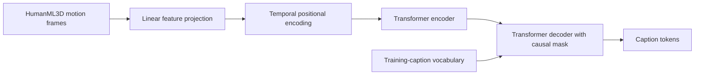

# Pose2Text

Pose2Text is a research project that maps a sequence of 3D human motion features to a natural-language caption. It uses a PyTorch Transformer encoder-decoder and is designed for HumanML3D. This initial release accepts preprocessed motion arrays; it does not extract poses from RGB video.

## Architecture



HumanML3D's official README describes matching ID-named motion and text files, split lists, optional mean/std arrays, `new_joint_vecs` features, and `new_joints` coordinates. This loader uses full-sequence annotations (start and end are both zero), preserves multiple captions as separate paired training examples, and supports either available feature directory. The dimensionality is read from the actual array rather than assumed. See the [official HumanML3D repository](https://github.com/EricGuoICT/HumanML3D) and its README for processing details and terms.

## Dataset

Obtain HumanML3D via the official project instructions; the dataset is not bundled here. Extract at minimum the split text files, `texts/`, and one of `new_joint_vecs/` or `new_joints/`. `Mean.npy` and `Std.npy` are used if present and dimension-compatible. `new_joint_vecs` is the default 263-ish dimensional representation; `new_joints` contains coordinate sequences and has a different dimension.

Expected extracted layout:

```text
HumanML3D/
  texts/000000.txt
  new_joint_vecs/000000.npy   # or new_joints/000000.npy
  train.txt
  val.txt
  test.txt
  Mean.npy                   # optional
  Std.npy                    # optional
```

The source data has its own access and redistribution conditions. Do not redistribute HumanML3D or infer that this code's license grants data rights. Cite Guo et al., *Generating Diverse and Natural 3D Human Motions from Text*, CVPR 2022, and follow the upstream repository's current terms.

## Install and run

Python 3.10+ is recommended. On Windows PowerShell or Linux/macOS:

```bash
python -m venv .venv
# Windows: .venv\Scripts\Activate.ps1
# Linux/macOS: source .venv/bin/activate
pip install -r requirements.txt
python scripts/check_dataset.py --data-root data/HumanML3D
python -m pytest -q
python scripts/train.py --config configs/default.yaml
python scripts/evaluate.py --checkpoint checkpoints/best.pt
streamlit run app.py
```

Set `data_root` and, if needed, `motion_dir` in YAML. Configure batch size, epochs, maximum motion/caption lengths, and model dimensions there. Training automatically selects CUDA when available, clips gradients, reduces learning rate on validation plateaus, and saves the best validation checkpoint. `--overfit` enables a small training subset for debugging. `--smoke-test` selects the synthetic toy path and must not be presented as a real-data experiment.

Quick smoke test (requires installed dependencies):

```bash
python scripts/train.py --config configs/smoke_test.yaml --smoke-test
```

The smoke run writes a toy checkpoint and validation history under `checkpoints/smoke` and `results/smoke`. It does not provide benchmark metrics. Real evaluation writes `results/metrics.json`, `predictions.csv`, and `model_comparison.csv`; validation loss history is written during training. The comparison uses a train-caption majority baseline and nearest-motion retrieval based on train-standardized concatenated temporal mean, standard deviation, and endpoint displacement. Test motions are excluded from retrieval training and same-ID retrieval is explicitly masked.

## Colab

Open [Pose2Text_Colab_Final (1).ipynb](notebooks/Pose2Text_Colab_Final%20(1).ipynb) in Google Colab. The notebook checks the runtime/GPU, mounts Google Drive, reuses the saved trained checkpoint and evaluation when available, and displays saved metrics and test predictions. The recorded runtime was Python 3.13.16, PyTorch 2.11.0+cu130, and a Tesla T4 GPU.

The notebook's saved configuration records a 2,000-example training limit, 3 epochs, batch size 16, and the HumanML3D `new_joint_vecs` representation. The notebook detected an existing saved checkpoint and evaluation and skipped retraining/re-evaluation in that session. See the notebook outputs for the exact run state.

## Metrics and limitations

Evaluation calculates BLEU-1 through BLEU-4 with NLTK sentence BLEU and smoothing, ROUGE-L with `rouge-score`, and METEOR with NLTK over all available full-sequence references. Tokenization is lowercase alphanumeric regex; scores are macro-averaged over test motions. If the NLTK WordNet data needed by METEOR is unavailable, its value is recorded as unavailable. BERTScore is reported as not run unless separately implemented with installed model dependencies; CIDEr is optional and currently not implemented. Metric scores are imperfect proxies for semantic correctness.

The demo shows a model-generated caption only when a checkpoint exists, references from the selected test motion, and an illustrative feature trace. Skeleton rendering is available only for actual `(frames, joints, 3)` coordinate arrays; 263D feature vectors are not joint coordinates. Video upload and pose extraction are not supported.

## Reproducibility and results

The following values are from the notebook's saved `results/metrics.json` and `results/model_comparison.csv`, for the HumanML3D test split (`4,384` examples). Scores are shown to four decimal places.

| Model | BLEU-1 | BLEU-2 | BLEU-3 | BLEU-4 | ROUGE-L | METEOR |
|---|---:|---:|---:|---:|---:|---:|
| **Transformer** | **0.5151** | **0.3668** | **0.2296** | **0.1523** | **0.4274** | 0.3473 |
| Majority caption | 0.3080 | 0.2101 | 0.1086 | 0.0841 | 0.3551 | **0.6416** |
| Nearest motion | 0.4570 | 0.2771 | 0.1631 | 0.1061 | 0.3886 | N/A |

**Reading the results:** The Transformer has the highest BLEU-1 through BLEU-4 and ROUGE-L among the three evaluated methods. The majority-caption baseline has the highest reported METEOR. Nearest-motion METEOR is unavailable (`null`) in the saved metrics file and is therefore shown as N/A, not zero.

**Evaluation caveats:** These results represent the saved evaluation in the notebook; they should not be interpreted as a full-dataset training result. The notebook's saved configuration specifies `train_limit: 2000` and `epochs: 3`. Automatic caption metrics are imperfect proxies for semantic correctness. BERTScore was not run because its optional package/model weights were not installed or downloaded; CIDEr is not implemented.

Random seeds are configurable (`seed`); checkpoint includes model, optimizer, epoch, vocabulary, and config. Data, model checkpoint, and dependency licenses remain governed by their respective owners.

Future work: beam search, coordinate-aware skeleton visualization in the app, BERTScore/CIDEr integration, and richer motion encoders.
